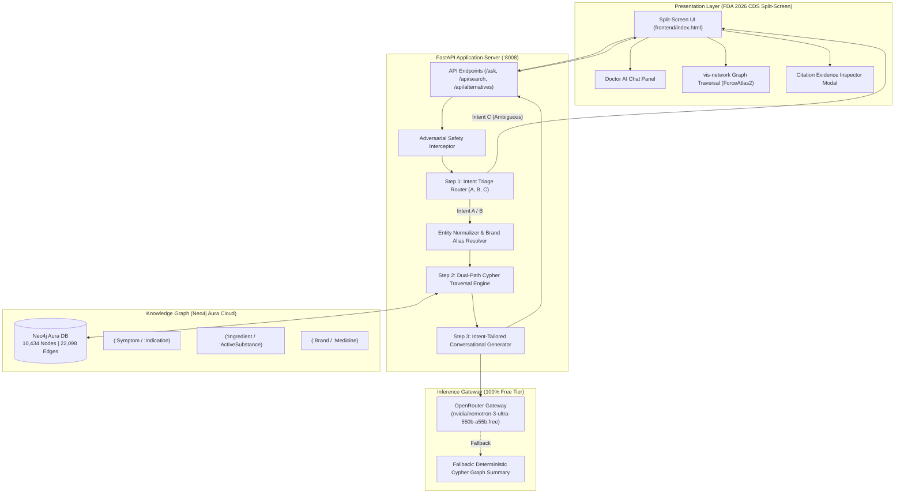
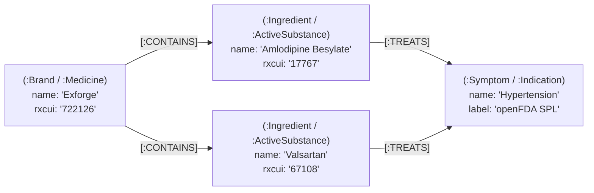

<div align="center">

# ⚕️ MedGraph Nexus
### *FDA 2026 CDS-Compliant Clinical Decision Support & Neuro-Symbolic GraphRAG System*

[](https://neo4j.com/)
[-6366F1?style=for-the-badge)](https://openrouter.ai/)
[](https://fastapi.tiangolo.com/)
[](#-regulatory-compliance--fda-2026-cds)
[](https://visjs.org/)
[](LICENSE)

<p align="center">
  <b>A clinical decision-support and pharmaceutical discovery engine that eliminates LLM hallucinations by grounding queries in a 10,434-node heterogeneous Neo4j Knowledge Graph with deterministic multi-hop traversal and granular footnote evidence citations.</b>
</p>

</div>

---

## 📑 Table of Contents
- [Overview](#-overview)
- [Why GraphRAG Over Traditional Vector RAG](#-why-graphrag-over-traditional-vector-rag)
- [Core Capabilities](#-core-capabilities)
  - [1. Two-Step Prompting & Intent Triage Router](#1-two-step-prompting--intent-triage-router)
  - [2. Split-Screen Reviewable Layout](#2-split-screen-reviewable-layout)
  - [3. Interactive Multi-Hop Graph Traversal](#3-interactive-multi-hop-graph-traversal)
  - [4. Granular Footnote Micro-Citations & Evidence Inspector](#4-granular-footnote-micro-citations--evidence-inspector)
  - [5. Medical Entity Normalization & Brand Alias Resolution](#5-medical-entity-normalization--brand-alias-resolution)
- [System Architecture](#-system-architecture)
- [Knowledge Graph Schema & Ontologies](#-knowledge-graph-schema--ontologies)
- [REST API Endpoints](#-rest-api-endpoints)
- [Quickstart & Local Setup](#-quickstart--local-setup)
- [Regulatory Compliance (FDA 2026 CDS)](#-regulatory-compliance--fda-2026-cds)
- [Repository Structure](#-repository-structure)
- [License](#-license)

---

## 📖 Overview

**MedGraph Nexus** is a production-grade **Clinical Decision Support (CDS) platform** built for healthcare professionals (HCPs), clinical pharmacotherapists, and researchers. By bridging official **openFDA Structured Product Labeling (SPL)** with the **NIH National Library of Medicine (RxNorm)**, the platform models deep biochemical, clinical, and regulatory relationships in an enterprise **Neo4j Knowledge Graph** (10,434 nodes, 22,098 relationships).

The platform transforms raw clinical queries into verifiable, deterministic reasoning paths:
$$\text{[Queried Drug]} \xrightarrow{\text{CONTAINS}} \text{[Active Chemical Ingredient]} \xrightarrow{\text{TREATS}} \text{[Symptom / Indication]} \xleftarrow{\text{CONTAINS}} \text{[Alternative Brands]}$$

Every claim synthesized by Doctor AI is paired with clickable footnote citations (`[1]`, `[2]`), unedited regulatory drug label text, and interactive force-directed graph paths, ensuring complete auditability and zero hallucination.

---

## 🔬 Why GraphRAG Over Traditional Vector RAG

Standard Dense Passage Retrieval (DPR) and vector embeddings fail in clinical pharmacology due to structural limitations:

| Architectural Challenge | Traditional Vector RAG | MedGraph Nexus GraphRAG |
| :--- | :--- | :--- |
| **Relational Reasoning** | **Semantic Drift**: Fuzzily clusters related terms (*"Lipitor"*, *"cholesterol"*, *"statin"*, *"liver enzymes"*) without knowing which drug bioequivalently replaces another. | **Deterministic Multi-Hop Traversal**: Executes strict relational joins. If an edge does not exist in the graph, no drug pairing is hallucinated. |
| **Chunk Fragmentation** | Arbitrary 500-token boundaries slice boxed warnings away from approved indications, leading to dangerous advice. | **Atomic Property Modeling**: Warnings, indications, and RxCUIs are stored as atomic properties bound directly to the medicine node. |
| **Brand Alias Resolution** | Fails when a user queries commercial names (`"Lipitor"`) if the database only ingested generic names (`"Atorvastatin"`). | **Canonical Entity Linking**: Resolves brand aliases (`Lipitor → Atorvastatin`) and normalizes compound clinical terms (`"high blood pressure" → "hypertension"`). |
| **Hallucination Control** | Top-k chunks are fed to the LLM regardless of relevance; the LLM extrapolates from pre-trained memory. | **Zero-Context Strict Refusal**: If traversal yields zero matching clinical nodes, the system halts with a standardized refusal. |
| **Auditability & Traceability** | Generates opaque paragraphs with vague document-level links (*"Source: fda_labels.pdf"*). | **Token-Level Micro-Citations**: Every claim contains interactive citations (`[1]`, `[2]`) opening exact FDA label text and NIH RxCUI/TTY mappings. |

---

## 🌟 Core Capabilities

### 1. Two-Step Prompting & Intent Triage Router
Before any database query is executed, incoming queries pass through a pre-retrieval **Intent Classifier**:
* **Category A (Symptom-to-Medicine)**: User describes symptoms or conditions (*"high blood pressure"*, *"my head is pounding"*). The system executes backward traversal from `(:Symptom)` to active ingredients and brand formulations.
* **Category B (Medicine-to-Alternative)**: User queries a brand or chemical (*"what are alternative brands for Lipitor?"*). The system executes downward traversal from `(:Brand)` / `(:Ingredient)` to bioequivalent alternatives and therapeutic indications.
* **Category C (Ambiguous)**: User inputs brief or vague terms (*"pressure"*, *"meds"*). The system **skips database queries entirely** and responds immediately with a polite clarifying question.

### 2. Split-Screen Reviewable Layout
Built to comply with **FDA Section 520(o)(1)(E)**:
* **Left Panel**: Conversational Doctor AI synthesis with flowing clinical paragraphs, drug class mechanisms, and footnote citations.
* **Right Panel (Reviewable Grounding Hub)**: Tabbed clinical workstation featuring:
  * **Interactive Graph Traversal Canvas**
  * **Raw openFDA & RxNorm Data Cards** (unedited indications, contraindications, boxed warnings, RxCUIs)
  * **Citation Evidence Inspector**

### 3. Global Multilingual GraphRAG & Cross-Lingual Normalization
* **6 Supported Consultation Languages**: Full end-to-end support for **English (`en`)**, **Spanish (`es`)**, **French (`fr`)**, **German (`de`)**, **Hindi (`hi`)**, and **Telugu (`te`)**.
* **Cross-Lingual Entity Resolution**: Users can express medical conditions in their native tongue (e.g., French *"mal de tête"*, German *"Kopfschmerzen"*, Spanish *"dolor de cabeza"*, Hindi *"सिरदर्द"*). The Intent Router normalizes the entity to canonical English clinical concepts (`Headache`) to traverse the FDA knowledge graph, and synthesizes the clinical findings in the selected language with interactive entity tokens (`**[Entity]**`) and openFDA citations.

### 3. Interactive Multi-Hop Graph Traversal
Integrated using `vis-network` with the ForceAtlas2 physics solver:
* Dynamically visualizes the complete reasoning pathway:
  $$\text{🔴 Symptom} \longleftrightarrow \text{🔵 Active Ingredient} \longleftrightarrow \text{🟢 Marketed Brand}$$
* Clicking any node in the graph automatically highlights connected relationships and scrolls to the corresponding raw FDA card in the data inspector.

### 4. Granular Footnote Micro-Citations & Evidence Inspector
* Every active substance, brand alternative, approved indication, and safety precaution in the AI prose features an interactive footnote citation (`[1]`, `[2]`).
* Clicking any citation badge opens the **Citation Evidence Inspector modal**, displaying:
  * **Source**: `openFDA Drug Label & NIH RxNorm`
  * **Ontology Mapping**: Exact `RxCUI` and Term Type (`TTY: IN / BN`)
  * **Unedited Evidence**: Verbatim manufacturer prescribing information excerpt.

### 5. Medical Entity Normalization & Brand Alias Resolution
* **Compound Phrase Normalization**: Normalizes colloquial multi-word phrases to canonical medical concepts:
  $$\text{"high blood pressure" / "blood pressure"} \longrightarrow \text{"hypertension"}$$
  $$\text{"head pounding" / "throbbing head"} \longrightarrow \text{"headache"}$$
* **Commercial Brand Resolver**: Maps commercial trade names to active chemical entities (`Lipitor → Atorvastatin`, `Tylenol → Acetaminophen`, `Norvasc → Amlodipine`, `Advil → Ibuprofen`, `Aleve → Naproxen`, etc.).
* **Lexical Specificity Filtering**: Prunes weak, ambiguous stopwords (`"pressure"`, `"blood"`, `"high"`) that would otherwise cause false-positive matches in unindexed label scans.

---

## 🏗️ System Architecture



---

## 📊 Knowledge Graph Schema & Ontologies

The production graph is hosted on **Neo4j Aura Cloud** and harmonizes two federal clinical standards:
* **openFDA Drug Labels (SPL)**: Product-level trade names, raw indications, contraindications, and black box warnings.
* **NIH RxNorm (NLM)**: Clinical drug nomenclature, normalized RXCUIs, and Term Types (`IN` = Active Ingredient, `BN` = Brand Name, `MIN` = Multi-Ingredient).



### Graph Statistics:
* **Total Graph Nodes**: `10,434`
* **Total Graph Edges**: `22,098`
* **Master Medicines / Brands**: `3,191`
* **Active Substances / Ingredients**: `2,362`
* **Medical Indications / Symptoms**: `3,136`
* **Pharmacologic Drug Classes**: `468`
* **Therapeutic Specialties**: `14`

---

## 🔌 REST API Endpoints

The FastAPI backend runs on port `8008` with automatic Swagger UI documentation at `http://localhost:8008/docs`:

| Endpoint | Method | Description |
| :--- | :---: | :--- |
| `/api/search` | `POST` | Primary natural language endpoint. Runs Intent Router $\rightarrow$ Targeted Graph Traversal $\rightarrow$ Conversational Generator. Returns answer, graph nodes/edges, raw clinical records, and citations. |
| `/ask` | `POST` | Backwards-compatible endpoint for web frontends with multi-turn chat history support. |
| `/api/alternatives/{brand_name}` | `GET` | Direct graph lookup endpoint. Traverses `(:Brand)-[:CONTAINS]->(:Ingredient)<-[:CONTAINS]-(:Alternative)` for a specific pharmaceutical trade name. |
| `/api/health` | `GET` | System liveness probe returning Neo4j connectivity and active node counts. |

---

## ⚡ Quickstart & Local Setup

### Prerequisites
* **Python**: 3.10+
* **Neo4j Database**: AuraDB Cloud or local Neo4j instance
* **OpenRouter API Key**: [OpenRouter.ai](https://openrouter.ai/) (Zero-cost free model: `nvidia/nemotron-3-ultra-550b-a55b:free`)

### 1. Clone the Repository
```bash
git clone https://github.com/slyvarun/medgraph-ai-service.git
cd medgraph-ai-service
```

### 2. Configure Environment Variables
Create a `.env` file in the project root:
```env
# Database Credentials (Neo4j Aura Cloud Free Tier)
NEO4J_URI="neo4j+s://your-instance-id.databases.neo4j.io"
NEO4J_USER="neo4j"
NEO4J_PASSWORD="your-neo4j-password"

# LLM Gateway Credentials (Free Tier MoE Model)
OPENROUTER_API_KEY="sk-or-v1-your-openrouter-key"
OPENROUTER_MODEL="nvidia/nemotron-3-ultra-550b-a55b:free"

# Optional: High-Throughput APIs
OPEN_FDA_API="your-openfda-key"
RXNORM_API_KEY="your-rxnorm-key"
```

### 3. Install Dependencies
```bash
pip install -r backend/requirements.txt
```

### 4. Start the Application Server
```bash
python -m uvicorn backend.ai_service:app --host 0.0.0.0 --port 8008 --reload
```

### 5. Access the Platform
* **Web UI (Split-Screen CDS Workstation)**: Open [http://localhost:8008](http://localhost:8008) in any modern browser.
* **Interactive API Documentation (Swagger)**: [http://localhost:8008/docs](http://localhost:8008/docs)

---

## 🛡️ Regulatory Compliance (FDA 2026 CDS)

MedGraph Nexus is architected in accordance with **Section 520(o)(1)(E) of the FD&C Act** and FDA's 2026 guidance for Clinical Decision Support software:

1. **Reviewable Basis**: Clinicians are never forced to accept generative summaries blindly. The dual-screen layout provides simultaneous access to the AI conversational explanation and the unedited openFDA/RxNorm records.
2. **Deterministic Explainability**: Visualizes the exact relationship path taken through the graph, proving the deterministic logic behind every recommendation.
3. **Traceable Citations**: Every claim is linked via clickable footnote badges (`[1]`, `[2]`) to official SPL manufacturer inserts and RxCUI ontologies.
4. **Persistent Intended Use Disclaimer**: Non-dismissible regulatory banner establishing that MedGraph Nexus is an informational reference tool intended to assist, not replace, clinical judgment.

---

## 📁 Repository Structure

```
medgraph-ai-service/
├── backend/
│   ├── ai_service.py              # FastAPI server, Intent Router, GraphRAG engine, and OpenRouter client
│   ├── requirements.txt           # Python backend dependencies
│   └── Procfile                   # Cloud container deployment configuration
├── frontend/
│   ├── index.html                 # Split-screen CDS workstation (vis-network, citations, raw FDA tab)
│   └── streamlit_app.py           # Rapid-prototyping Streamlit alternative UI
├── pipelines/
│   ├── build_full_clinical_graph.py  # Bulk 14-partition openFDA & RxNorm harvester
│   ├── curate_clinical_dataset.py    # Cosmetic/non-drug purge & entity resolution engine
│   ├── fetch_drug_relations.py       # Live openFDA & NIH RxNorm REST connector
│   └── ingest_graph.py               # Neo4j Aura batch UNWIND Cypher loader
├── docs/
│   └── EXPERT_AIML_PROJECT_OVERVIEW.md # Comprehensive AI/ML evaluation & engineering thesis
├── .env.example                   # Environment configuration template
├── .gitignore                     # Git ignore rules
└── README.md                      # Primary project documentation
```

---

## 📜 License

Distributed under the **MIT License**. See `LICENSE` for details.

<div align="center">
  <b>Built with precision for explainable pharmacology, patient safety, and clinical decision support.</b>
</div>
